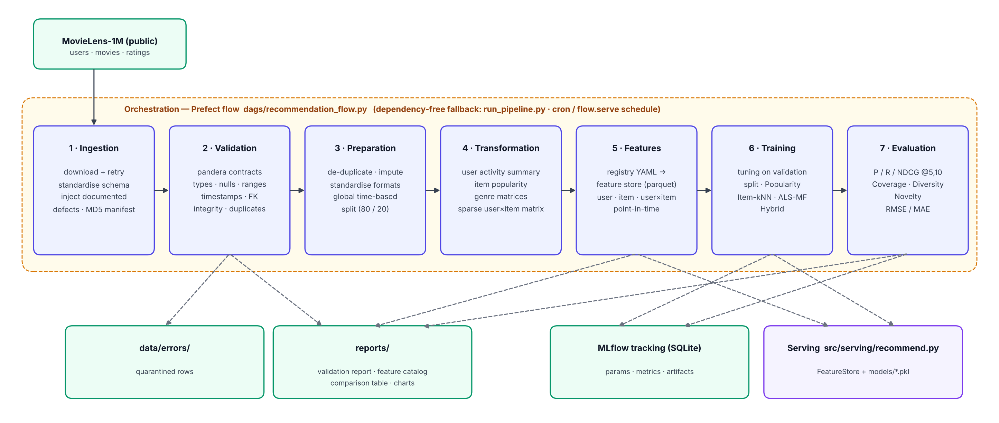

# End-to-End Data Management Pipeline for a Movie Recommendation System

**DM4ML – Assignment 2 · BITS Pilani WILP (M.Tech AI/ML)**
Soma Sekhar Reddy Vattakula · 2025AG05032

A modular, reproducible pipeline that takes the public **MovieLens-1M** dataset from raw files to evaluated
recommendation models:

```
Ingestion → Validation → Preparation → Transformation → Feature Management → Training → Evaluation
                         (all orchestrated as a Prefect flow, with a plain-Python fallback)
```



## Headline results (future test period, K = 10)

| Model | Precision@10 | Recall@10 | NDCG@10 | Coverage@10 | Diversity@10 | RMSE | MAE |
|---|---|---|---|---|---|---|---|
| Popularity (baseline) | 0.1985 | 0.0479 | 0.2129 | 0.0374 | 0.7600 | 0.9595 | 0.7597 |
| Item-kNN CF | 0.1912 | 0.0548 | 0.2124 | 0.1436 | 0.7370 | – | – |
| ALS Matrix Factorisation | 0.0954 | 0.0256 | 0.1006 | 0.1671 | 0.7904 | **0.8941** | **0.6956** |
| **Hybrid (CF + MF + features)** | **0.2265** | **0.0646** | **0.2489** | 0.1092 | 0.7443 | – | – |

The hybrid model beats the popularity baseline by **+16.9 % NDCG@10** and **+35 % Recall@10** while recommending
~3× more of the catalogue. Full tables (K = 5 and 10, HitRate, MAP, Novelty) are in
[`reports/model_comparison.md`](reports/model_comparison.md).

## Repository layout

```
recommendation-pipeline/
├── configs/pipeline.yaml          # single source of configuration (paths, seed, rules, hyper-params)
├── src/
│   ├── common/utils.py            # config, logging, IO helpers
│   ├── ingestion/ingest.py        # 1 download + standardise + (documented) defect injection + manifest
│   ├── validation/                # 2 pandera schemas + validation runner, error quarantine, report
│   ├── preparation/prepare.py     # 3 cleaning, imputation, standardisation, time-based split
│   ├── transformation/transform.py# 4 activity summary, item popularity, genre matrices, user-item matrix
│   ├── features/                  # 5 feature_registry.yaml, build_features.py, feature_store.py
│   ├── training/                  # 6 models.py (4 recommenders), train.py (tuning + MLflow), context.py
│   ├── evaluation/                # 7 metrics.py, evaluate.py (comparison table + chart)
│   ├── serving/recommend.py       # prediction CLI reusing the feature store + models
│   └── pipeline.py                # stage registry + dependency graph (shared by orchestrators)
├── dags/recommendation_flow.py    # Prefect flow (orchestration DAG)
├── run_pipeline.py                # dependency-free orchestrator (cron-friendly)
├── scripts/show_mlflow_runs.py    # prints tracked params/metrics from MLflow
├── data/{raw,processed,features,errors}/   # created by the pipeline (git-ignored)
├── models/                        # pickled models + model_registry.json (MLflow run ids)
├── reports/                       # validation report, feature catalog, model comparison, screenshots
├── docs/                          # architecture diagram + final report (PDF)
├── tests/                         # unit tests for metrics + DAG order
├── requirements.txt · Makefile
```

## Setup

```bash
git clone https://github.com/<your-github-username>/recommendation-pipeline.git
cd recommendation-pipeline
python3 -m venv .venv && source .venv/bin/activate      # Python 3.11+
pip install -r requirements.txt
```

The raw data (~38 MB) is **downloaded automatically** on the first run from a public GitHub mirror of
MovieLens-1M. Offline? Put `users.csv`, `movies.csv`, `ratings.csv` (tab-separated mirror format) in a folder and
`export RECSYS_SOURCE_DIR=/path/to/folder`.

## Running

| What | Command |
|---|---|
| Full pipeline (Prefect flow) | `python dags/recommendation_flow.py` |
| Full pipeline, no Prefect | `python run_pipeline.py` |
| One stage | `python run_pipeline.py --stage validate` (ingest · validate · prepare · transform · features · train · evaluate) |
| A stage and everything downstream | `python run_pipeline.py --from train` |
| Daily schedule (02:00 IST) | `python dags/recommendation_flow.py --serve` |
| Prefect UI | `prefect server start` then, in another terminal, `export PREFECT_API_URL=http://127.0.0.1:4200/api` before running the flow |
| MLflow UI | `mlflow ui --backend-store-uri sqlite:///mlflow.db` → http://127.0.0.1:5000 (switch to *Model training*) |
| Recommendations for a user | `python -m src.serving.recommend --user 635 --model hybrid --k 10` |
| Tests | `python -m pytest -q tests` |

A full run takes about 1 minute on a laptop (most of it is hyper-parameter tuning).

## Stage details

### 1 · Ingestion — `src/ingestion/ingest.py`
Downloads users / movies / ratings with retries and caching, standardises them to a common contract
(`users(user_id, gender, age, occupation, zipcode)`, `items(item_id, title, genres)`,
`interactions(user_id, item_id, rating, timestamp)`), and writes raw CSVs plus `data/raw/ingestion_manifest.json`
(row counts, MD5 checksums, source, timestamp).

MovieLens is already clean, so the stage **injects a small, seeded, logged set of realistic defects** (880 rows:
nulls, wrong types such as `"five"`, out-of-range ratings, future / pre-1997 timestamps, orphan user/item IDs,
exact and re-rating duplicates). Every injected defect is recorded in `data/raw/injected_defects_log.csv`, and
the validation stage cross-checks that it caught all of them. Set `ingestion.inject_anomalies: false` to ingest
the data untouched.

### 2 · Validation — `src/validation/`
Pandera `DataFrameSchema` contracts plus custom checks. Each rule has a severity:

| Rule | Severity | Action |
|---|---|---|
| wrong_type, missing_key, invalid_rating, invalid_timestamp, orphan_user, orphan_item | error | row quarantined to `data/errors/<table>_errors.csv` with reasons |
| duplicate_row, duplicate_interaction, missing_attribute, invalid_age / gender / occupation | warning | row passes, logged to `data/errors/<table>_warnings.csv`, fixed in preparation |

Report: [`reports/validation_report.md`](reports/validation_report.md). Result: 520 interaction rows
quarantined (99.948 % pass rate); 100 % of injected error-type defects detected. The Prefect flow adds a
**data-quality gate** that fails the run if more than 1 % of interactions are quarantined.

### 3 · Preparation — `src/preparation/prepare.py`
De-duplicates (re-ratings → latest kept), imputes (gender → `U`, invalid age → mode, missing genres → `Unknown`),
standardises (int/float types, UTC `event_time`, 5-digit zip codes, genre names, release year and clean title
parsed from the title). **Time-based split**: one global cut-off at the 80th time percentile (2000-12-02), so
every training interaction happens before every test interaction. Test is restricted to warm users/items;
cold-start rows are counted and reported.

### 4 · Transformation — `src/transformation/transform.py`
Built from the train split only: `user_activity_summary`, `item_popularity` (count, mean, Bayesian-smoothed
rating, rank), `item_genre_matrix`, `user_genre_profile`, and the sparse `user_item_matrix` (CSR, 5,392 ×
3,662, 4.05 % dense) with id↔index maps.

### 5 · Feature management — `src/features/`
`feature_registry.yaml` declares each feature (entity, dtype, source, description). `build_features.py`
materialises them into a file-based feature store (`data/features/*.parquet` + metadata with MD5s and
as-of time), fails if a declared feature was not produced, and generates the
**[feature catalog](reports/feature_catalog.md)** with live statistics. `FeatureStore` serves the same features to
training, evaluation and prediction (`get_user_features`, `get_item_features`, on-demand
`get_user_item_features`). 28 feature definitions: e.g. user average rating, activity count, preferred genre,
days since last interaction, mainstreaminess; item popularity, average / Bayesian rating, recency, age;
user×item genre affinity and rating gap.

### 6 · Training — `src/training/`
Four models behind one interface (`fit / score / recommend / predict_rating`):

* **Popularity** (baseline): most-rated unseen items, read from the feature store.
* **Item-kNN CF**: shrunk cosine item–item similarity, top-N neighbours.
* **ALS matrix factorisation**: biased explicit MF trained with ALS-WR; predicts ratings (RMSE/MAE).
* **Hybrid**: weighted blend of item-kNN, ALS, user×item genre affinity and item popularity (feature store).

Hyper-parameters are tuned on a **validation split carved from the last 10 % of the train period** (never the
test set), then models are refit on the full train split. MLflow tracks every tuning trial (nested runs) and
final run: parameters, data/feature lineage (cut-off, row counts, feature MD5s), training time, ALS loss curve,
pickled model and feature metadata as artifacts. `models/model_registry.json` links each model to its run id.

### 7 · Evaluation — `src/evaluation/`
Precision, Recall, NDCG, HitRate and MAP at K = 5 and 10; catalogue Coverage; intra-list genre Diversity
(1 − Jaccard); Novelty; RMSE / MAE for rating models. Metrics are logged back into each model's MLflow run, and a
comparison table, chart and sample recommendations go to `reports/`.

### Orchestration — `dags/recommendation_flow.py`, `run_pipeline.py`
The DAG is declared once (`src/pipeline.py`). The Prefect flow wires the seven tasks with explicit `wait_for`
dependencies, retries ingestion, enforces the data-quality gate, and can be served on a cron schedule.
`run_pipeline.py` runs the same DAG in topological order without Prefect, skips downstream stages when one
fails, and returns a non-zero exit code (cron-friendly).

### Reproducibility
Single config file · fixed seed (42) for defect injection, ALS initialisation and sampling · source checksums in
the ingestion manifest · feature-store MD5s logged to MLflow · deterministic splits. Re-running the pipeline gives
identical metrics (three runs are visible in the MLflow screenshot with the same results).

## Deliverables index

| Deliverable | Location |
|---|---|
| Source code (modular) | `src/`, `dags/`, `run_pipeline.py` |
| Setup / execution instructions | this README |
| requirements.txt | `requirements.txt` |
| Architecture diagram | `docs/architecture.png` |
| Data validation report / logs | `reports/validation_report.md`, `reports/validation_report.json`, `reports/pipeline_run.log` |
| Feature catalog | `reports/feature_catalog.md` (+ `.csv`) |
| Model evaluation comparison | `reports/model_comparison.md` (+ `.csv`, `figures/model_comparison.png`), `reports/tuning_results.csv` |
| Orchestration DAG + successful run screenshot | `dags/recommendation_flow.py`, `reports/screenshots/` |
| Final report (PDF) | `docs/DM4ML_Assignment2_Report.pdf` |

## Dataset
F. Maxwell Harper and Joseph A. Konstan. 2015. *The MovieLens Datasets: History and Context.* ACM TiiS 5(4).
MovieLens-1M © GroupLens Research, University of Minnesota — used for non-commercial academic purposes.
