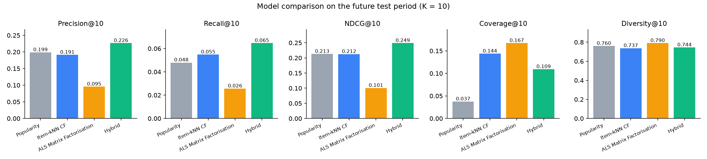

# Model Evaluation Results

Test set = ratings after the time cut-off (2000-12-02), warm users/items only: 103,783 ratings, 1,135 users. Relevant = rating ≥ 4. Already-seen items are excluded from recommendations.

## Main results (K = 10)

| Model | Precision@10 | Recall@10 | NDCG@10 | HitRate@10 | Coverage@10 | Diversity@10 | Novelty@10 | RMSE | MAE |
|---|---|---|---|---|---|---|---|---|---|
| Popularity (baseline) | 0.1986 | 0.0479 | 0.2129 | 0.6284 | 0.0374 | 0.7601 | 1.4128 | 0.9595 | 0.7597 |
| Item-kNN CF | 0.1912 | 0.0548 | 0.2124 | 0.6221 | 0.1436 | 0.7370 | 1.9984 | – | – |
| ALS Matrix Factorisation | 0.0954 | 0.0256 | 0.1006 | 0.4434 | 0.1671 | 0.7904 | 4.3955 | 0.8941 | 0.6956 |
| Hybrid (CF + MF + features) | 0.2265 | 0.0646 | 0.2489 | 0.6732 | 0.1092 | 0.7443 | 1.8716 | – | – |

## K = 5

| Model | Precision@5 | Recall@5 | NDCG@5 | Coverage@5 | Diversity@5 |
|---|---|---|---|---|---|
| Popularity (baseline) | 0.2090 | 0.0261 | 0.2214 | 0.0246 | 0.7150 |
| Item-kNN CF | 0.2153 | 0.0334 | 0.2296 | 0.1065 | 0.7168 |
| ALS Matrix Factorisation | 0.1032 | 0.0134 | 0.1046 | 0.1212 | 0.7738 |
| Hybrid (CF + MF + features) | 0.2503 | 0.0392 | 0.2655 | 0.0808 | 0.7203 |

RMSE/MAE are reported for models that predict explicit ratings (popularity predicts the item's Bayesian-average rating).

